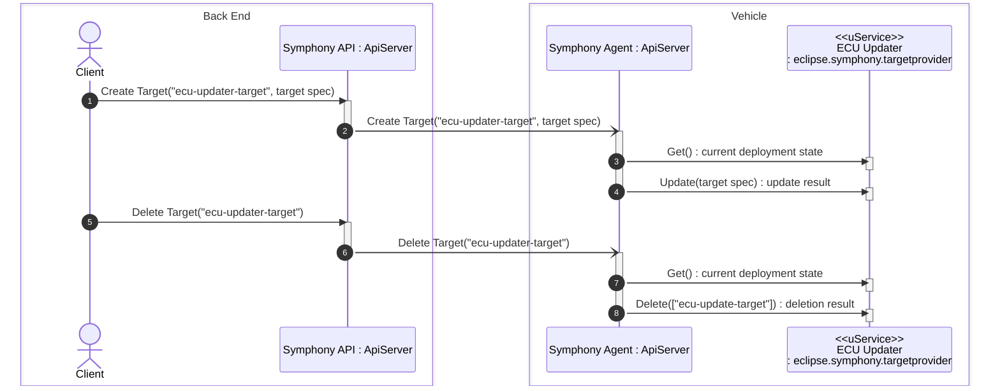
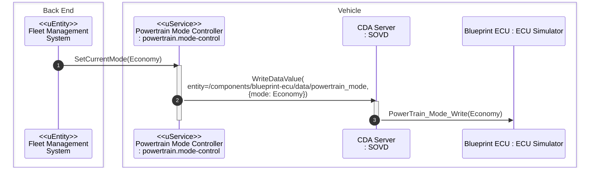

# Commercial Vehicle Use Cases based on Eclipse SDV Software Components

This repository contains artifacts that implement a few use cases that are (not exclusively) relevant for commercial vehicles.
The artifacts have been implemented using open source components created by the Eclipse SDV community and other projects.

Use cases currently include:
* Over-the-Air (OTA) firmware updates of ECUs
* OTA configuration changes of ECUs

## Top Level View

The following diagram provides an overview of the components used for the example use cases and their relationship to each other:


### Services and Networks

The [Docker Compose file](docker-compose.yaml) runs the backend and a simulated vehicle on a single host. Services are grouped into profiles, which are selected using the `--profile` option:

| Compose service | Profiles | Networks | Responsibility |
| :-------------- | :------- | :------- | :------------- |
| `dozzle` | `infra` | default | Displays container logs in a browser |
| `spire-server` | `infra`, `fw-update`, `powertrain` | `backend` | Provides the key material for creating and verifying JWTs |
| `spire-agent-backend` | `infra`, `fw-update`, `powertrain` | `backend` | Issues JWTs to backend workloads via the SPIFFE Workload API |
| `spire-agent-vehicle` | `infra`, `fw-update`, `powertrain` | `backend` | Issues JWTs to in-vehicle workloads via the SPIFFE Workload API |
| `mosquitto` | `infra`, `fw-update`, `powertrain` | `backend`, `vehicle-uprotocol` | Carries Symphony messages and uProtocol communication using MQTT |
| `symphony-api` | `fw-update` | `backend` | Accepts deployment target specifications in the backend |
| `symphony-portal` | `fw-update` | `backend` | Provides a read-only view of Symphony targets and deployment progress |
| `symphony-agent` | `fw-update` | `vehicle-uprotocol` | Reconciles the desired deployment state with the in-vehicle target provider |
| `ecu-updater` | `fw-update` | `vehicle-uprotocol` | Implements the Symphony target provider operations over uProtocol; keeps firmware deployment state in memory |
| `fms` | `powertrain` | `backend` | Represents the Fleet Management System; sets powertrain modes and logs vehicle properties events |
| `databroker` | `powertrain` | `vehicle-uprotocol` | Hosts vehicle information using Eclipse Kuksa and VSS metadata |
| `vehicle-properties` | `powertrain` | `vehicle-uprotocol` | Makes vehicle properties from the Databroker available as uProtocol events |
| `powertrain-mode-controller` | `powertrain` | `vehicle-uprotocol`, `vehicle-sovd` | Exposes uProtocol operations for reading and setting the powertrain mode via SOVD |
| `sovd-cda` | `powertrain` | `vehicle-sovd` | Maps SOVD resources to UDS operations using preprocessed diagnostic definitions |
| `ecu-sim` | `powertrain` | `vehicle-sovd` | Simulates a DoIP-connected ECU, including powertrain mode read/write operations |

The networks model logical boundaries between backend communication, in-vehicle uProtocol services and vehicle diagnostics. They do not represent a production vehicle security architecture.

### Host Ports

| Service | Default host address | Notes |
| :------ | :------------------- | :---- |
| Dozzle | http://localhost:8080 | Container list and live logs |
| Symphony API | http://localhost:8082/v1alpha2/greetings | Returns `Hello from Symphony K8s control plane (S8C)` |
| Symphony Portal | http://localhost:3000 | Log in as `admin` with an empty password |
| SOVD API (CDA) | http://localhost:20002/vehicle/v15 | Host port configurable via `CDA_PORT` |
| ECU Simulator control API | http://localhost:8181 | Host port configurable via `SIM_CONTROL_PORT` |
| Kuksa Databroker | `localhost:55555` | gRPC endpoint, not a browser UI |
| MQTT broker | `localhost:1883` | MQTT endpoint, not a browser UI |

When using a remote development host or dev container, `localhost` refers to the machine running Docker. Forward the required ports to the machine running your browser instead of making the demo endpoints publicly accessible.
Host names like `sovd-cda` or `mosquitto` can only be resolved from within the Compose networks.

## Prerequisites

- A development machine with Docker Engine or Docker Desktop running and Docker Compose v2 installed.
- Git to clone the repository.
- Bash, `curl` and `jq` to run the scripts and example requests.
- A browser for Dozzle and the Symphony Portal.
- Internet access to the GitHub Container Registry (`ghcr.io`) and Docker Hub for pulling container images.

No physical ECU, Kubernetes cluster, local Rust toolchain or local JVM is needed when using the published container images.

### Security Notes

Use a trusted development host only. The stack uses demo credentials, an unsecured (non-TLS) connection to the Kuksa Databroker, and Dozzle as well as the Spire agents mount the host's Docker socket. Do not deploy the configuration unchanged on a public server or in a production vehicle.

All ports listed under [Host Ports](#host-ports) are bound to the loopback interface (`127.0.0.1`) only. The host address and port of the CDA and ECU Simulator control APIs can be changed using the `CDA_PORT` and `SIM_CONTROL_PORT` environment variables, see [A Port Is Already in Use](#a-port-is-already-in-use). Review firewall rules and access controls before binding any service to other interfaces.

## Getting Started

The repository contains a [Docker Compose file](docker-compose.yaml) which can be used to start up all
components implementing the example use cases. To get started, run the following command

```bash
# Using the default Docker Compose file in the top level folder:
docker compose --profile infra up -d
# Or if your docker-compose.yaml file is located in a different folder:
# docker compose -f /path/to/your/docker-compose.yml up -d
```

This will start up some common infrastructure components, which are shared by all needed for all cases.
You can now open _Dozzle_ in your browser at http://localhost:8080 and see the running infrastructure containers and inspect their log output.

## Configure Authorization

Some of the service components that implement the use cases in this blueprint use JSON Web Tokens (JWT) to authenticate and authorize clients. The tokens are issued by [Spire](https://spiffe.io) agents running in the backend and on the vehicle. These agents are connected to a Spire server in the backend which provides the key material need for creating and verifying the tokens. The workload components then use the agent's _SPIFFE Workload API_ to create and/or validate tokens. For this to work, the workloads need to be registered with the Spire server by running the following script:

```bash
scripts/register_workloads.sh
```

After successful workload registration, the use cases can be run as described in the following sections.

## Run the Deploy Firmware Use Case

Start the required components and services by running:

```bash
# Using the default Docker Compose file in the top level folder:
docker compose --profile infra --profile fw-update up -d
```

In the Dozzle console you should now see a few additional containers running.

### Verify Access to Services

* To check access to Symphony's REST API, you can send a test request by opening http://localhost:8082/v1alpha2/greetings in your browser.
  The response should be: `Hello from Symphony K8s control plane (S8C)`
* To check access to the read-only Symphony Portal, point your browser to http://localhost:3000.
  Login with user `admin` without a password. You should see the Symphony portal page.
  During your experiments, the portal can used to determine the progress of updates by means of checking the _Targets_.

### Trigger Firmware Update

* The firmware components to deploy are described in the [target specification](scripts/target.json).
* Optionally, follow the vehicle-side logs in a second terminal (Dozzle is an alternative log viewer):

  ```bash
  docker compose --profile infra --profile fw-update logs --follow --tail=50 symphony-agent ecu-updater
  ```

Now that the infrastructure is up and running, it is time to trigger the update of some ECU firmware images using the Symphony API:

```bash
# From the repository root folder
scripts/trigger_ecu_update.sh
```

This will create a new _Target_ in Symphony and deploy two firmware files to it:

* The logs of the `ecu-updater` container should contain something similar to

  ```log
  [2026-06-01T14:26:29Z INFO  ecu_updater::ecu_target] installing firmware [name: Engine Controller, FW Image: "https://acme.io/fw/engine-control-1.45.img"]
  [2026-06-01T14:26:29Z INFO  ecu_updater::ecu_target] installing firmware [name: Telematics Unit, FW Image: "https://non-existent.io/fw/telematics-unit-2.0.img"]
  ```

* A corresponding entry should show up under the _Targets_ tab in the Symphony Portal web UI.

After hitting _Enter_ in the terminal where you ran the shell script:

* The firmware files will be removed from the target.
  In the logs of the `ecu-updater` container, you should see something similar to:

  ```log
  [2026-06-01T14:26:53Z INFO  ecu_updater::ecu_target] removing firmware [Engine Controller]
  [2026-06-01T14:26:53Z INFO  ecu_updater::ecu_target] removing firmware [Telematics Unit]
  ```
* The _ecu-updater-target_ in Symphony will be removed after a few seconds.

The sequence diagram below shows the flow of messages through the system for triggering the firmware update:



1. The _Client_ uploads a new target deployment specification by means of an HTTP POST request to the _Symphony API_ server in the back end. The target specification contains the details of the firmware images to be updated.
2. The _Symphony API_ server forwards the target spec to the _Symphony Agent_ running on the vehicle by means of an MQTT message.
3. The _Symphony Agent_ determines the current deployment status of the _ECU Updater_ deployment target by means of invoking its _Get_ operation via uProtocol.
4. The _Symphony Agent_ triggers the installation of the firmware by means of invoking the _Update_ operation with the changed components of the target specification via uProtocol.

**Note** The ECU Updater in this example use case does not actually deploy any firmware images to any ECU but only maintains some state in memory. In a future extension of the blueprint, the OpenSOVD CDA server might be used to actually perform an ECU update via UDS.

### Clean Up an Interrupted Run

If the script was stopped before it removed the target (e.g. using Ctrl+C), the `ecu-updater-target` remains registered in Symphony. Remove it manually before running the script again:

```bash
SYMPHONY_BASE_URL=http://localhost:8082/v1alpha2
SYMPHONY_TOKEN=$(curl --fail-with-body -sS -X POST \
  -H 'Content-Type: application/json' \
  --data '{"username":"admin","password":""}' \
  "$SYMPHONY_BASE_URL/users/auth" | jq -er '.accessToken')

curl --fail-with-body -sS -X DELETE \
  -H "Authorization: Bearer $SYMPHONY_TOKEN" \
  "$SYMPHONY_BASE_URL/targets/registry/ecu-updater-target"
```

Wait for the target to disappear from the Symphony Portal before retrying.

## Run the Set Powertrain Mode Use Case

In this use case, a Fleet Management System in the backend uses the _Powertrain Mode Controller_ uService on the vehicle to cycle the vehicle's powertrain through all supported modes.

For this purpose, the Powertrain Mode Controller invokes the Powertrain ECU's _PowerTrain_Mode_Write_ UDS operation by means of the [Eclipse OpenSOVD's Classic Diagnostic Adapter](https://github.com/eclipse-opensovd/classic-diagnostic-adapter) (CDA) component.
The CDA exposes an HTTP based API that can be used by clients to interact with ECUs via UDS over DoIP.

The Powertrain ECU is represented by a modified version of the ECU Simulator component that is part of OpenSOVD's test infrastructure. In particular, it has been modified to expose _PowerTrain_Mode_Read_ and _PowerTrain_Mode_Write_ operations.

Start the required components and services by running:

```bash
# Using the default Docker Compose file in the top level folder:
docker compose --profile infra --profile powertrain up -d
```

The setting of the powertrain mode can be traced through the system by means of the container logs, which you can examine in the Dozzle console.

* The log file of the Fleet Management System contains entries like these:
  ```log
  [2026-06-02T09:12:14Z INFO  fms] setting powertrain mode to Economy
  ...
  [2026-06-02T09:12:19Z INFO  fms] setting powertrain mode to Performance
  ```
* The log file of the Powertrain Mode Controller contains entries like these:
  ```log
  [2026-06-02T09:13:25Z INFO  powertrain] Setting current powertrain mode to SOVD server at http://sovd-cda:20002/vehicle/v15/components/blueprint-ecu/data/powertrain_mode
  [2026-06-02T09:13:25Z INFO  powertrain] Powertrain mode set to: Economy
  ```
* The log file of the ECU Simulator contains entries like these:
  ```log
  Set PowerTrain Mode: 2
  09:13:25.536 DEBUG [DefaultDispatcher-worker-10] SimEcu blueprint-ecu Request for blueprint-ecu: '2E 4E 66 02' matched '{ PowerTrain_Mode_Write; Bytes: 2E 4E 66 [] }' -> Send response '6E 4E 66'
  ```

The FMS, Powertrain Mode Controller and CDA components also log information about the JWTs that are created and validated at _DEBUG_ level.

Some more hints for following the use case:

* To follow the complete chain in a terminal instead of Dozzle, run:
  ```bash
  docker compose --profile infra --profile powertrain logs --follow --tail=100 fms powertrain-mode-controller sovd-cda ecu-sim
  ```
* The FMS waits five seconds after each completed RPC before requesting the next mode change. The changes continue until the FMS or the stack is stopped.
* A log entry of the FMS only shows which mode has been requested. Check the ECU Simulator's log for the corresponding `PowerTrain_Mode_Write` request to verify that the change has reached the ECU.
* Pause the FMS before manually experimenting with the ECU, so that it does not overwrite your changes, and resume it afterwards:
  ```bash
  docker compose --profile infra --profile powertrain stop fms
  docker compose --profile infra --profile powertrain start fms
  ```

The sequence diagram below shows the flow of messages for setting the current mode on the powertrain ECU:



1. The _Fleet Managament System_ sets the powertrain mode to _Economy_ by means of a uProtocol RPC call to the _Powertrain Mode Controller_.
2. The _Powertrain Mode Controller_ sets the powertrain mode to _Economy_ by updating corresponding SOVD entity's data value by means of an HTTP PUT request on the _CDA Server_.
3. The _CDA Server_ sets the powertrain mode to _Economy_ by means of invoking the _Powertrain_Mode_Write_ operation on the _Blueprint ECU_ via UDS.

### What's in the Box?

The Docker Compose file starts up the following components:

- The `ecu-sim` service is a basic DoIP-connected ECU simulation built on the [doip-sim-ecu framework](https://github.com/doip-sim-ecu). It acts as the southbound conterpart for the classic-diagnostic-adapters diagnostic communication.
- The `sovd-cda` service is in essence an SOVD-to-UDS bridge. It uses ODD/PDX diagnostic definitions (pre-processed by OpenSOVD [odx-converter](https://github.com/eclipse-opensovd/odx-converter)) to populate its SOVD API, mapping those resources to corresponding UDS communication with connected ECUs (via DoIP).
- The `powertrain-mode-controller` service is a uProtocol entity that exposes a _setCurrentMode_ operation that can be used by other uProtocol entities to set the vehicle's powertrain mode.
- The `fms` service is a uProtocol entity that represents a Fleet Management System running in the back end. The service periodically invokes the _setCurrentMode_ operation to toggle the powertrain's mode of operation between _Economy_ and _Performance_.

The repository also contains the [odx](odx/) directory, which is a copy of the OpenSOVD Classic Diagnostic Adapter testcontainer, containing Python scripts for generating example ODX data using the [odxtools](https://github.com/mercedes-benz/odxtools) library.

### Modifications

This project copy of the upstream CDA testcontainer is modified to better represent the uServices PoC use cases, by:

- creating appropriately named ODX service definitions (by modifying the odx generation scripts)
- implementing the ecu-sim counterpart to these services (by modifying the ecu-simulation code)

### Service APIs

- SOVD API: http://localhost:20002/vehicle/v15
- ECU Simulator Control API: http://localhost:8181

#### Example Requests

```sh
ACCESS_TOKEN=$(curl -s -X POST -H "Content-Type: application/json" --data '{"client_id":"test", "client_secret":"secret"}' "http://localhost:20002/vehicle/v15/authorize" | jq -r .access_token)

# retrieve standardized resource collection for ECU (+ variant)
curl -s -X GET -H "Authorization: Bearer $ACCESS_TOKEN" "http://localhost:20002/vehicle/v15/components/blueprint-ecu" | jq .

# force variant detection
curl -s -X PUT -H "Authorization: Bearer $ACCESS_TOKEN" "http://localhost:20002/vehicle/v15/components/blueprint-ecu"

# acquire component lock
curl -s -X POST -H "Authorization: Bearer $ACCESS_TOKEN" -H "Content-Type: application/json" --data '{"lock_expiration": 100000}' "http://localhost:20002/vehicle/v15/components/blueprint-ecu/locks"

# switch into extended session
curl -s -X PUT -H "Authorization: Bearer $ACCESS_TOKEN" -H "Content-Type: application/json" --data '{"value": "extended"}' "http://localhost:20002/vehicle/v15/components/blueprint-ecu/modes/session"

# switch sim to boot variant
curl -s -X PUT -H "Content-Type: application/json" --data '{"variant": "BOOT"}' "http://localhost:8181/blueprint-ecu/state"

```

## Stop and Clean Up

If you are running the firmware update use case, finish the script by pressing _Enter_ so that it removes its target. Then stop all components:

```bash
docker compose --profile infra --profile fw-update --profile powertrain down
```

This keeps the named volumes (Mosquitto data and logs, Spire agent sockets). To start from a completely fresh environment, also delete these volumes and their contents:

```bash
docker compose --profile infra --profile fw-update --profile powertrain down --volumes
```

Neither command deletes any repository files. Note that the ECU Updater's deployment state and the Spire server's workload registrations are not persisted. After the containers have been recreated, run `scripts/register_workloads.sh` again.

## Troubleshooting

Run all commands from the repository root folder. If you have set the `CDA_PORT` and `SIM_CONTROL_PORT` variables, keep them set for all Docker Compose commands.

### Check Container Status and Logs

```bash
docker compose --profile infra --profile fw-update --profile powertrain ps --all
docker compose --profile infra --profile fw-update --profile powertrain logs --tail=100
```

Look for exited containers, an unhealthy ECU Simulator or MQTT broker, and repeated connection or authentication errors. The MQTT broker and ECU Simulator have health checks, but a running container alone does not prove that all downstream APIs are ready yet. Transient RPC failures right after startup are therefore normal.

### Docker Is Not Reachable

If `docker version` does not report a server version, start Docker Engine or Docker Desktop and make sure that your user can access the Docker socket. Do not make the socket world-writable to work around access errors.

### Container Images Cannot Be Pulled

Check registry access, your network connection and whether the published images support your host's architecture:

```bash
docker compose --profile infra --profile fw-update --profile powertrain pull
```

Alternatively, the images of the blueprint's own components can be built locally, see [uServices](uservices/README.md#building).

### A Port Is Already in Use

Stop the conflicting local service or change the host port mapping. The CDA and ECU Simulator host ports can be configured using environment variables:

```bash
export CDA_PORT=127.0.0.1:20003
export SIM_CONTROL_PORT=127.0.0.1:8182
docker compose --profile infra --profile powertrain up -d
```

In this example, use http://localhost:20003/vehicle/v15 and http://localhost:8182 from the host. The service addresses within the Compose networks remain unchanged. Changing other host ports requires changes to the Compose file.

### Firmware Target Does Not Reach the ECU Updater

Make sure that the Symphony greeting works and that the target shows up in the Symphony Portal. Then inspect the orchestration chain:

```bash
docker compose --profile infra --profile fw-update logs --tail=150 symphony-api symphony-agent ecu-updater mosquitto
```

Check that the Symphony Agent and the ECU Updater are connected to the MQTT broker. Note that the trigger script does not check the HTTP responses of the Symphony API, so the _Press Enter_ prompt also appears if a request has failed. Review the script's output, and check that `jq` is installed and that authentication returned a token.

Only one run of the script should manage the `ecu-updater-target` at a time. Remove a stale target before retrying, see [Clean Up an Interrupted Run](#clean-up-an-interrupted-run).

### Powertrain Modes Do Not Change

```bash
docker compose --profile infra --profile powertrain logs --tail=150 fms powertrain-mode-controller sovd-cda ecu-sim mosquitto
```

Check the chain in order: the FMS requests, uProtocol/MQTT connectivity, the controller's SOVD destination, the CDA responses and the simulator's UDS requests. If you have paused the FMS before, resume it using `docker compose --profile infra --profile powertrain start fms`.

If you have changed the ECU's lock, session or variant (see [Example Requests](#example-requests)), go back to the baseline by recreating the simulator and the CDA. This interrupts active diagnostic connections:

```bash
docker compose --profile infra --profile powertrain up -d --force-recreate ecu-sim sovd-cda
```

### Report an Issue

Open an [issue](https://github.com/eclipse-sdv-blueprints/commercial-sdv-stack/issues) and include your host OS and architecture, the Docker and Compose versions, the failing step, the container status and relevant log excerpts. Remove tokens, credentials and sensitive vehicle data before sharing any output.
